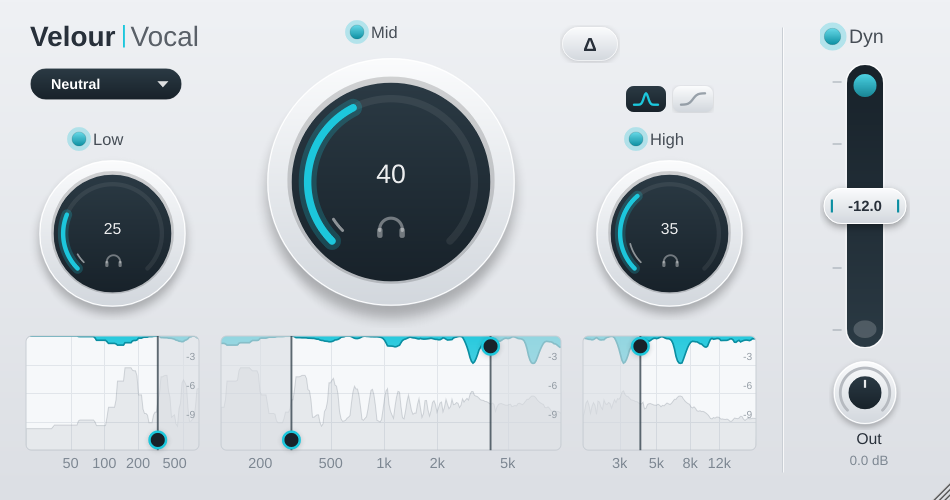

# Velour Vocal

A dynamic resonance suppressor for vocals (VST3 / AU / Standalone, built with JUCE 8).
It finds harsh, boxy or sibilant resonances in real time and turns them down only
while they stick out, across three bands, instead of using static EQ cuts.



## How it works

STFT processing (Hann window, 75 % overlap, FFT size 2048 at 44.1/48 kHz, 4096 at
88.2/96 kHz, 8192 at 176.4/192 kHz so frequency resolution stays about the same).
For every frame:

1. **Detail curve**: the spectrum lightly smoothed across frequency, wide enough to blur
   individual voice harmonics (the width depends on the voice profile).
2. **Envelope**: a wide moving average of the detail curve in log frequency (computed
   twice, with peaks clamped on the 2nd pass so a big resonance can't raise its own reference).
3. **Reduction**: wherever detail is above envelope, that bin is compressed toward the
   envelope. Ratio goes from 1:1 (Amount 0) to 5:1 (Amount 100), scaled per band.
4. **Smoothing**: per-bin attack/release over time, then light smoothing across frequency,
   to avoid flutter and "musical noise".
5. The same gain curve is applied to all channels (stereo image is kept), then inverse
   FFT and overlap-add.

Latency is exactly one FFT size and is reported to the host, so the DAW compensates for it.
Bypass keeps the STFT running, so latency stays constant and toggling bypass doesn't click.

| Control | What it does |
|---|---|
| **Low / Mid / High** knobs | Amount per band (0–100). The thin white inner ring shows live gain reduction. |
| LED next to band name | Band on/off |
| Headphone icon | Solo: hear only that band (processed) |
| Bell / shelf buttons | High band detection: **Focused** (narrow peaks, e.g. sibilance) or **Broad** (wider, gentler) |
| Profile menu | Male / Female / Neutral: tunes harmonic blur width and timing, and snaps crossovers to typical points (only when *you* pick it, never on session load) |
| Displays | Grey = input spectrum, teal = gain reduction (scale 0–12 dB). Drag the round handles to move crossovers (Low/Mid 150–600 Hz, Mid/High 2–8 kHz); double-click resets. |
| **Δ** | Delta: output only what's being removed |
| **Dyn** fader | Threshold 0 to −24 dB. With Dyn on, processing eases off below the threshold (down to 10 % at 18 dB below it) and gets up to 60 % stronger above it. Teal bar = overall gain reduction, grey bar = input level. |
| **Out** | Output gain, −12 to +12 dB |

All parameters are automatable (`AudioProcessorValueTreeState`). The window is
resizable (75 %–200 %), and its size is saved with the session.

## Project layout

```
CMakeLists.txt              JUCE via ./JUCE submodule if present, else FetchContent (8.0.9)
Source/
  Parameters.h/.cpp         parameter IDs, ranges, voice-profile defaults
  PluginProcessor.h/.cpp    APVTS, latency, bypass, output gain
  DSP/
    SpectralSuppressor.*    the STFT resonance suppressor (real-time safe)
    DisplayFifo.h           lock-free audio->UI snapshot queue
  UI/
    Theme.h                 colours / fonts
    VelourLookAndFeel.*     look-and-feel + custom buttons + ArcKnob
    BandKnob.*              LED + knob + solo for one band
    BandDisplay.*           spectrum / gain-reduction view with crossover handles
    DynFader.*              threshold fader with meters
    PluginEditor.*          layout, 30 fps metering timer
Tests/DSPTests.cpp          offline DSP checks (no DAW needed)
```

## Building

Requirements: CMake 3.22+, Git, and a C++17 compiler. JUCE is downloaded automatically
on first configure (or add it as a submodule: `git submodule add https://github.com/juce-framework/JUCE.git JUCE`
and check out tag `8.0.9`).

### macOS (Xcode 14+)

```bash
cmake -B build -G Xcode
```

```bash
cmake --build build --config Release
```

Outputs are in `build/VelourVocal_artefacts/Release/` (`VST3/`, `AU/`, `Standalone/`).
To have the build copy plugins into `~/Library/Audio/Plug-Ins/{VST3,Components}`, add
`-DVELOUR_COPY_PLUGIN_AFTER_BUILD=ON` to the first command. For a universal binary add
`-DCMAKE_OSX_ARCHITECTURES="arm64;x86_64"`.

### Windows (Visual Studio 2022)

```bash
cmake -B build -G "Visual Studio 17 2022" -A x64
```

```bash
cmake --build build --config Release
```

The VST3 is in `build\VelourVocal_artefacts\Release\VST3\Velour Vocal.vst3`. Copy that
folder to `C:\Program Files\Common Files\VST3\` (or configure with
`-DVELOUR_COPY_PLUGIN_AFTER_BUILD=ON` from an Administrator prompt). AU is macOS-only and is skipped on Windows.

### Linux (also works)

Install JUCE's dependencies (`libasound2-dev libx11-dev libxrandr-dev libxinerama-dev
libxcursor-dev libfreetype-dev libfontconfig1-dev libgl-dev`), then:

```bash
cmake -B build -G Ninja -DCMAKE_BUILD_TYPE=Release && cmake --build build
```

## Testing

### 1. Offline DSP tests

```bash
cmake --build build --target VelourVocalTests --config Release
```

Then run `build/VelourVocalTests_artefacts/Release/VelourVocalTests` (add `.exe` on Windows).
It checks: perfect reconstruction at every sample rate from 44.1 to 192 kHz with random
block sizes, that a planted resonance is cut while nearby noise is left alone, band
isolation, processed + delta == dry, solo, bypass transparency, the Dyn section, no
NaN/Inf on silence/DC/full-scale noise, and CPU speed.

### 2. Standalone

Run `Standalone/Velour Vocal(.app/.exe)`, open **Options → Audio/MIDI Settings**, pick your
interface and a mic input, and use headphones (avoids feedback).

### 3. In a DAW

1. Build, copy the plugin to the system folder (above), then rescan plugins
   (Logic: AU, validated by `auval -v aufx VlVc Velr`; Reaper/Ableton/Cubase/Studio One/FL: VST3).
2. Put it on a vocal track. Start with Mid ~40, High ~35 (Focused), Low ~20.
3. Press **Δ** to hear what's being removed. It should sound like thin, honky/harsh fragments,
   not the whole voice. If you hear the whole voice, lower the amounts.
4. Solo each band (headphone icon) and drag the crossovers on the middle display.
5. Turn on **Dyn** and set the fader so the grey input bar crosses it only on loud phrases.
6. Check delay compensation: duplicate the track without the plugin, flip polarity on one,
   set all amounts to 0. The sum should null (silence).
7. Optional: validate with [pluginval](https://github.com/Tracktion/pluginval) at strictness 5+.

## Notes

- Real-time safety: everything is allocated in `prepareToPlay`; the audio thread uses no
  locks or allocation. Meters are atomics; spectrum snapshots go through a fixed-size
  lock-free FIFO at ~40 Hz, and the UI reads them at 30 fps.
- To rename the product, change `PRODUCT_NAME`, `COMPANY_NAME`, `BUNDLE_ID` and the
  4-letter `PLUGIN_MANUFACTURER_CODE` / `PLUGIN_CODE` in `CMakeLists.txt`. Changing the codes
  makes hosts see it as a different plugin.
